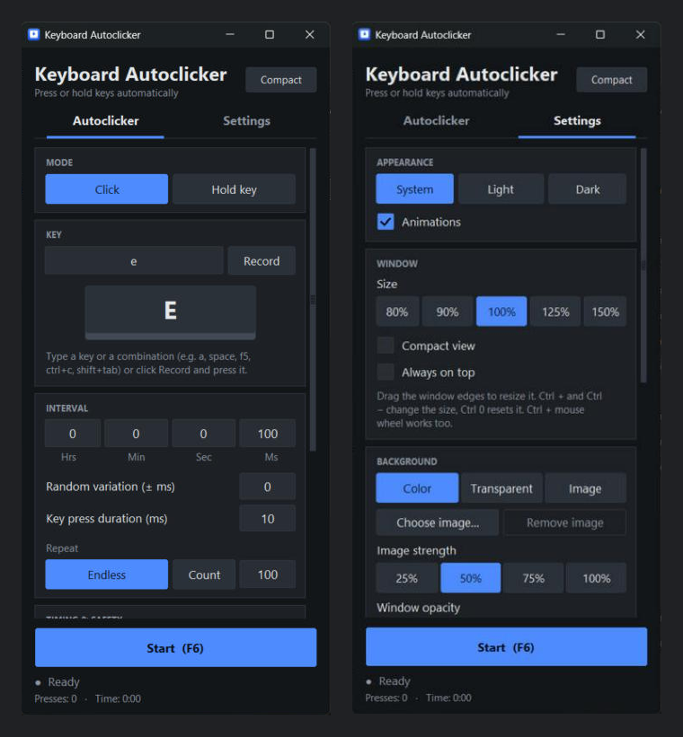

# Keyboard Autoclicker

Press or hold keys on your keyboard automatically – like OP Auto Clicker, but for the keyboard. For Windows 10 and 11.



## Features

- **Click mode:** press a key again and again. Set the interval (hours, minutes, seconds, milliseconds), a random variation, the key press duration, and run it endlessly or a fixed number of times.
- **Hold key mode:** keep a key pressed until you stop it. Optionally release it automatically after N seconds, and optionally send auto-repeat like a physically held key.
- **Key combinations** such as `ctrl+c`, `shift+tab` or `alt+f4`, for the key and for the hotkey.
- **Global hotkey** (default `F6`) to start and stop, also while another window is active.
- **Start delay with countdown**, a **press counter and running time**, and **stop after X minutes**.
- **Emergency stop** with `Esc` or by pushing the mouse into a screen corner.
- **Settings tab:** light, dark or system theme, your own accent color, custom background/card/text colors (saved per theme), and an animations switch.
- **Animations:** an on-screen key that is pressed whenever the program presses your key, plus smooth hover, click and tab transitions.
- **Resizable window:** drag the edges, scroll when it is small, choose a size from 80 % to 150 % (also Ctrl +/−/0), a **compact view** and **always on top**. Size and position are remembered.
- **Background:** plain color, **transparent** (Windows) or **your own picture**, plus **window opacity**.
- Saved settings and an optional **start with Windows** (minimized).
- **No stuck keys:** every key is released again when you stop, close the window or the program exits.
- **No terminal window.** One single EXE, plus an optional installer.

## Download

Get the latest `KeyboardAutoclicker_Setup.exe` (installer) or `KeyboardAutoclicker.exe` (portable, no installation) from the [Releases](../../releases) page. Requires Windows 10 or 11 (64-bit). The files are not code-signed. If Windows SmartScreen shows "Windows protected your PC", click **More info → Run anyway**.

## Quick start

1. Choose **Click** or **Hold key**.
2. Type the key or combination (for example `space`, `f5`, `ctrl+c`) or click **Record** and press it.
3. Set the timing.
4. Click into the window where the key should be pressed and press **F6**. Press **F6** again to stop.

The illustrated walkthrough is in [docs/INSTALLATION_GUIDE.pdf](docs/INSTALLATION_GUIDE.pdf) (its pictures show an earlier layout; the addendum pages at the end describe the current version). See [CHANGELOG.md](CHANGELOG.md) for what changed in each version.

## Build from source

Requirements: Windows, Python 3.10 or newer, optionally [Inno Setup 6](https://jrsoftware.org/isdl.php) for the installer.

```bat
pip install -r requirements.txt
python keyboard_autoclicker.py
```

Double-click `build_exe.bat` to build `dist\KeyboardAutoclicker.exe` and `Output\KeyboardAutoclicker_Setup.exe`. Double-click `Start_Keyboard_Autoclicker.pyw` to start without a terminal window and without building.

### Automatic builds on GitHub

Start `.github/workflows/build.yml` from the **Actions** tab to get the EXE and the installer as a build artifact. Pushing a version tag builds both files and attaches them to a **draft** release, using the notes from `RELEASE_NOTES.md`. A draft is never visible to others until you click **Publish release** on GitHub:

```bash
git tag v1.9.1
git push origin v1.9.1
```

## Settings

Saved in `%APPDATA%\KeyboardAutoclicker\settings.json`. Autostart uses the per-user entry `HKCU\Software\Microsoft\Windows\CurrentVersion\Run`.

## Privacy

The program listens to key presses only to detect your hotkey (and to record a key when you click **Record**). It does not log, store or send key presses and has no network code.

## Fair use

Do not use this tool in online games or other services whose rules forbid automation. Anti-cheat software may block simulated keys, and using an autoclicker there can lead to a ban.

## Third-party software

[pynput](https://github.com/moses-palmer/pynput) (LGPL-3.0), [Pillow](https://python-pillow.org) (MIT-CMU), [PyInstaller](https://pyinstaller.org), [Inno Setup](https://jrsoftware.org/isinfo.php).

## License

[MIT](LICENSE).
